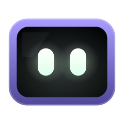

<p align="center">
  
</p>

<h1 align="center">Zodyvel</h1>
<p align="center"><b>A tiny island on top of your screen: AI agents, music and system load, all in one glance.</b></p>

<p align="center">
  <a href="https://github.com/shadow-lo/zodyvel-releases/releases/latest"></a>
  <a href="LICENSE"></a>
</p>
<p align="center">
  
  
  
  
  
</p>

A lightweight "island" that lives at the top center of your Windows screen: AI agent status and approvals (Claude Code, Codex), the music that is playing, and system load (CPU/RAM/GPU). Its mascot, and later its voice assistant, is **Zody**. There is also an optional Android companion app.

> Türkçe açıklama aşağıda. The app's interface is in Turkish.

## 💜 Meet Zody



Zody is the little screen-faced mascot with glowing eyes who lives on the island. It looks around while agents work, blinks when you hover, lights up its eyes in the color of the current state and perks up when an approval is waiting. Later it will also be the voice of the optional assistant.

<br clear="left">

## ⬇️ Install

Download the installer from the [latest release](https://github.com/shadow-lo/zodyvel-releases/releases/latest), run it, then move your mouse to the top center of the screen.

## ✨ Features

- 🤖 **AI agents:** live status of Claude Code / Codex sessions, approve or deny tool requests from the island (nothing is ever approved automatically; after 90 s the request falls back to the tool's own prompt).
- 🎵 **Music:** anything that supports Windows media controls (Spotify, YouTube in a browser, Media Player…).
- 📊 **System load:** the same CPU/RAM/GPU counters as Task Manager.
- 🧩 **Optional, off by default:** Zody assistant (uses your own `claude -p` login), phone bridge, mail/GitHub sources, local git overview.
- 🎮 Hides itself during full-screen games, videos and presentations.

## 🧱 Tech stack

Tauri 2 with a Rust core, a Svelte + TypeScript UI, Windows media and WebView2 APIs, and an optional Android companion (Tauri mobile).

## 🛠️ Build from source

Requirements: Node 24 LTS, pnpm, Rust (stable, MSVC), Visual Studio C++ build tools and the Windows 11 SDK. WebView2 ships with Windows 11.

```powershell
pnpm install
pnpm app          # dev: island + live reload
pnpm dev          # UI only, browser preview with sample data (no Tauri)
pnpm test         # UI tests (vitest)
pnpm check        # Svelte/TypeScript check
cd src-tauri; cargo test; cargo clippy -- -D warnings
pnpm tauri build --no-bundle   # optimized exe
pnpm package      # installer (NSIS)
```

If the project lives in a synced folder (OneDrive, Dropbox…), point the Rust build directory somewhere unsynced: copy `.cargo/config.example.toml` to `.cargo/config.toml` and edit the path.

Release signing keys are never part of the repo. `scripts/updater-key.mjs` creates an updater key in your user profile; the Android release build reads its keystore from a `keystore.properties` file given by the `ZV_KEYSTORE_PROPS` environment variable. If you fork the project, generate your own keys and change the updater `pubkey` and `endpoints` in `src-tauri/tauri.conf.json`.

## 🗂️ Layout

```text
src/island/             the island: shell, levels (views/), parts
src/settings/           settings window (loaded only when opened)
src/mascot/             Zody, the mascot drawn in code
src/lib/                state machine, store, IPC, sample data
src-tauri/src/          Rust core (agents, island window, pointer tracking, shortcuts, tray, sources…)
src-tauri/hook/         zodyvel-hook.exe and the shared protocol
src-tauri/phone-proto/  desktop ⇄ phone pairing and protocol
phone-app/              Android companion app (Tauri mobile)
tests/                  vitest tests
```

## 📄 License

[MIT](LICENSE)

---

## 🇹🇷 Türkçe

Windows ekranının üst ortasında yaşayan hafif ada: AI ajanlarının durumu ve onayları, çalan müzik, sistem yükü. Maskotu ve ileride sesli asistanı **Zody**. İsteğe bağlı bir Android eşlik uygulaması da var.

**Kurulum:** [Son sürümü](https://github.com/shadow-lo/zodyvel-releases/releases/latest) indir. Derleme adımları yukarıdaki **Build from source** bölümünde.

**Kullanım:** Fareyi ekranın üst ortasına götür, ada açılır. Tıkla: genel bakış, bir daha tıkla: tam panel. Esc ya da dışarı tıklamak küçültür. **Ctrl+Alt+Z** adayı açar/küçültür; onay kartı görünürken **Ctrl+Alt+Enter** onaylar, **Ctrl+Alt+Backspace** reddeder.

**Claude Code / Codex bağlamak:** Tepsideki Zodyvel → **Ayarlar…** → **Bağlantılar** → **Bağla…**, değişiklikleri incele → **Uygula**. Mevcut dosya yedeklenir; yalnız Zodyvel kayıtları eklenir. Sorun giderme için `ZODYVEL_DEBUG=1` ile başlat; olay adları `%LOCALAPPDATA%\Zodyvel\debug.log` dosyasına yazılır.
